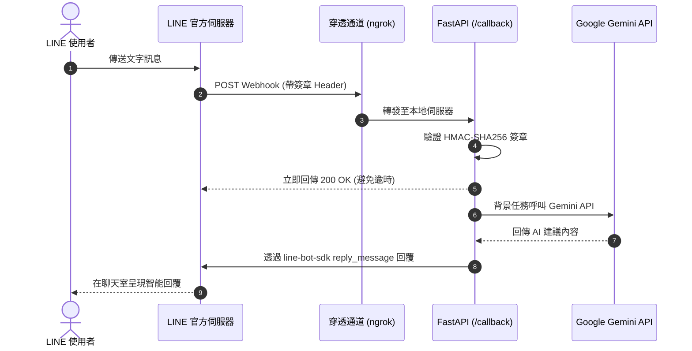

# 🤖 LINE Gemini Bot

一個基於 **FastAPI** 與 **Google Gemini API** 打造的現代化 LINE 智慧對話機器人。使用官方最新版 **`line-bot-sdk` (v3)**，支援非同步事件分發、安全簽章驗證與高度自訂 Prompt。

---

## ✨ 核心特色

- ⚡ **高效非同步架構**：採用 FastAPI 與 BackgroundTasks，以毫秒級速度向 LINE 回傳 200 OK，避免 Webhook 逾時。
- 🧠 **Google Gemini 核心**：串接 Google 最新 `gemini-2.5-flash` 模型，具備優秀的繁體中文語意理解與自然對話能力。
- 🛡️ **安全簽章驗證**：嚴格實作 HMAC-SHA256 簽章檢查（`X-Line-Signature`），抵禦偽造與惡意請求。
- ⚙️ **型別安全配置**：使用 `pydantic-settings` 搭配 `.env`，避免敏感金鑰外洩。
- 🩺 **健康檢查與診斷**：提供 `/` 端點即時檢視服務狀態與金鑰配置情形。

---

## 🏗️ 系統架構



---

## 📁 專案結構

```
line-bot-gemini/
├── app/
│   ├── __init__.py
│   ├── config.py             # 環境變數與設定載入 (Pydantic Settings)
│   ├── gemini_service.py     # Gemini AI 對話服務封裝與 Prompt 設計
│   ├── line_service.py       # LINE SDK v3 簽章驗證與回覆事件處理
│   └── main.py               # FastAPI 核心應用程式與 Webhook 路由器
├── .env.example              # 環境變數範本
├── .gitignore                # Git 忽略設定（保護金鑰不外流）
├── requirements.txt          # Python 依賴清單
├── test_gemini.py            # Gemini API 連線獨立測試腳本
└── README.md                 # 專案完整說明文件
```

---

## 🚀 快速上手指南

### 步驟 1：取得專案並安裝依賴

1. 複製專案：
   ```bash
   git clone https://github.com/haohsiangyang-0921/line-bot-gemini.git
   cd line-bot-gemini
   ```

2. 建立並啟動 Python 虛擬環境（建議 Python 3.10+）：
   ```bash
   # Windows
   python -m venv venv
   .\venv\Scripts\activate

   # macOS / Linux
   python3 -m venv venv
   source venv/bin/activate
   ```

3. 安裝必要套件：
   ```bash
   pip install -r requirements.txt
   ```

---

### 步驟 2：申請金鑰與憑證

#### 1. LINE Developers (Messaging API)
1. 登入 [LINE Developers Console](https://developers.line.biz/)。
2. 建立或選擇一個 **Provider**（提供者）。
3. 建立 **Create a Messaging API channel**：
   - 填寫 Channel 名稱、說明、大頭貼與類別。
4. 取得金鑰：
   - 前往 **Basic settings** 分頁，最下方複製 **Channel secret**。
   - 前往 **Messaging API** 分頁，最下方點擊 **Issue** 取得 **Channel access token (long-lived)**。
5. 前往 [LINE Official Account Manager](https://manager.line.biz/)：
   - 進入「回應設定」：
     - 回應模式：**聊天機器人**
     - 自動回應訊息：**關閉**
     - Webhook：**開啟**

#### 2. Google Gemini API
1. 前往 [Google AI Studio](https://aistudio.google.com/apikey)。
2. 登入 Google 帳號並點擊 **Create API key**。
3. 複製產生的 API Key。

---

### 步驟 3：配置環境變數

複製 `.env.example` 為 `.env`，並填入上述取得之金鑰：

```bash
cp .env.example .env
```

`.env` 內容如下：
```ini
LINE_CHANNEL_SECRET=你的_LINE_CHANNEL_SECRET
LINE_CHANNEL_ACCESS_TOKEN=你的_LINE_CHANNEL_ACCESS_TOKEN
GEMINI_API_KEY=你的_GEMINI_API_KEY
HOST=0.0.0.0
PORT=8000
```

---

### 步驟 4：測試 Gemini API 連線

在啟動 Webhook 前，可直接執行測試腳本確認 Gemini 能夠順利連線：

```bash
python test_gemini.py
```

若看見 Gemini 回覆的繁體中文問候訊息，即代表 AI 串接成功！

---

### 步驟 5：啟動本地伺服器

執行 FastAPI 伺服器：

```bash
uvicorn app.main:app --host 0.0.0.0 --port 8000 --reload
```

開啟瀏覽器造訪 `http://localhost:8000/`，若看到以下回應即代表服務運作正常：
```json
{
  "status": "healthy",
  "service": "LINE Gemini Bot",
  "configured": {
    "line_secret": true,
    "line_access_token": true,
    "gemini_api_key": true
  }
}
```

---

### 步驟 6：本地穿透測試 (ngrok)

由於 LINE 伺服器需要公開的 HTTPS 網址才能發送 Webhook，可使用 `ngrok` 進行穿透：

1. 下載並安裝 [ngrok](https://ngrok.com/)。
2. 執行指令：
   ```bash
   ngrok http 8000
   ```
3. 複製 ngrok 產生的 HTTPS 網址（例如 `https://xxxx-xx-xx.ngrok-free.app`）。
4. 前往 **LINE Developers Console** > 你的 Channel > **Messaging API** 分頁：
   - **Webhook URL** 填入：`https://xxxx-xx-xx.ngrok-free.app/callback`
   - 點擊 **Update** 後點擊 **Verify**，確認跳出 `Success`。
   - 開啟 **Use webhook** 開關。
5. 拿起手機掃描該頁面上的 QR Code 加入好友，開始傳送訊息與 AI 機器人聊天！ 🎉

---

## ☁️ 雲端部署選項

當本機測試完成後，可輕鬆部署至各大雲端平台以維持 24 小時不中斷運行：
- **Zeabur / Render**：直接連接 GitHub 儲存庫，填入環境變數即可一鍵部署。
- **Docker**：支援容器化打包，方便部屬至 GCP Cloud Run 或 AWS ECS。

---

## 📄 開源授權

本專案採用 [MIT License](LICENSE) 授權。歡迎自由修改、分享與二次開發！
